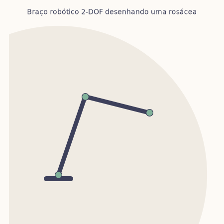

# 🦾 Braço Robótico 2-DOF: da matemática ao movimento

> *Dedicado à Leticia Mustafa.*

<p align="center">
  
</p>

Este projeto simula, em Python puro, um **braço robótico planar com dois graus de liberdade**, como um braço humano visto de cima, com ombro e cotovelo. Ele junta os três pilares da engenharia robótica num código curto e legível:

| Pilar | Pergunta que responde | Onde está no código |
|---|---|---|
| **Cinemática direta** | "Com as juntas nesses ângulos, onde está a mão?" | `BracoRobotico.posicoes()` |
| **Cinemática inversa** | "Quero a mão *ali*. Como dobro as juntas?" | `BracoRobotico.cinematica_inversa()` |
| **Controle** | "Como chego lá suave, sem tremer nem passar do ponto?" | `BracoRobotico.passo()` |

---

## 📐 1. Cinemática direta

O braço tem dois segmentos de comprimento `L1` e `L2`, girando nos ângulos `q1` (ombro) e `q2` (cotovelo, medido em relação ao braço). A posição da garra sai da soma de dois vetores:

```
x = L1·cos(q1) + L2·cos(q1 + q2)
y = L1·sin(q1) + L2·sin(q1 + q2)
```

É a parte fácil: dados os ângulos, calcular a posição é só trigonometria.

## 🔄 2. Cinemática inversa

Aqui está o desafio de verdade: **dado o ponto (x, y), quais ângulos levam a garra até lá?**

Base, cotovelo e garra formam um triângulo. Pela **lei dos cossenos**:

```
cos(q2) = (x² + y² − L1² − L2²) / (2·L1·L2)

q1 = atan2(y, x) − atan2(L2·sin(q2), L1 + L2·cos(q2))
```

Dois detalhes que todo robô real precisa tratar:

- **Duas soluções.** O mesmo ponto pode ser alcançado com o cotovelo "para cima" ou "para baixo" (`q2` positivo ou negativo). O código escolhe a mais próxima da posição atual, para o braço não dar uma cambalhota no meio do movimento.
- **Área de trabalho.** A garra só alcança pontos num anel entre `|L1 − L2|` e `L1 + L2`. Se o alvo estiver fora, o braço se estica o máximo possível na direção dele.

## 🎛️ 3. Controle PD

Um motor real não "teleporta" para o ângulo certo: ele tem inércia. Para chegar no alvo sem oscilar, cada junta usa um **controlador PD (Proporcional–Derivativo)**:

```
torque = Kp · erro − Kd · velocidade
```

- **Kp** (proporcional) puxa a junta na direção do alvo; quanto maior o erro, mais força.
- **Kd** (derivativo) funciona como um amortecedor e freia a junta para ela não passar do ponto.

Experimente mudar `kp` e `kd` em `robo.py`: com `kd` baixo o braço fica "elástico" e oscila; com `kd` alto ele fica lento e preguiçoso. Achar o equilíbrio é o que engenheiros de controle chamam de **sintonia**.

---

## 🌸 A flor

A curva desenhada no GIF é uma **rosácea**, definida em coordenadas polares por:

```
r = cos(k·θ)
```

Com `k = 5` ela tem cinco pétalas. A cada instante o programa calcula o próximo ponto da flor, a cinemática inversa transforma esse ponto em ângulos e o controlador PD move as juntas até lá. A flor é o rastro da garra.

## 🚀 Como rodar

```bash
pip install -r requirements.txt

# O braço segue o seu mouse em tempo real
python interativo.py

# O braço desenha a flor
python desenhar_flor.py

# Gera o GIF de novo (salva em img/flor.gif)
python desenhar_flor.py --gif
```

## 📁 Estrutura

```
.
├── robo.py            # modelo do braço: cinemática + controle
├── interativo.py      # modo "segue o mouse"
├── desenhar_flor.py   # demonstração da rosácea
├── img/flor.gif
└── requirements.txt
```

## 🔭 Próximos passos

- Adicionar a **dinâmica completa** (massas, gravidade, matriz de inércia) no lugar da inércia unitária
- Um termo **integral** (controle PID) para corrigir erros que ficam parados
- Um **terceiro grau de liberdade**, que traz infinitas soluções para a cinemática inversa
- Levar para o mundo físico com dois servomotores e um **Arduino** ou **ESP32**

---

<p align="center">
  Feito com 🦾 e trigonometria.
</p>
